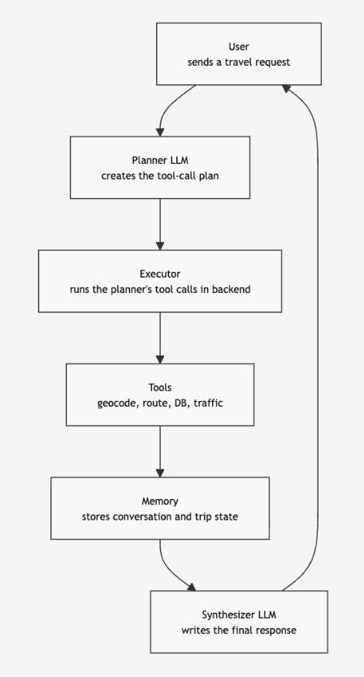
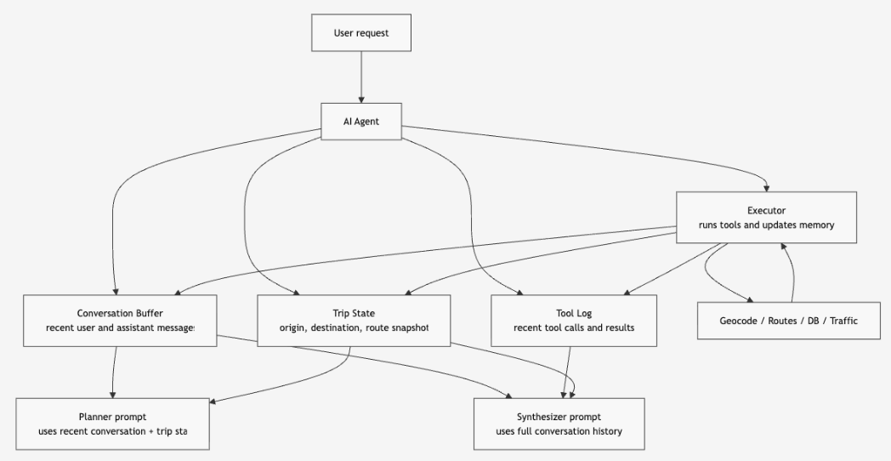
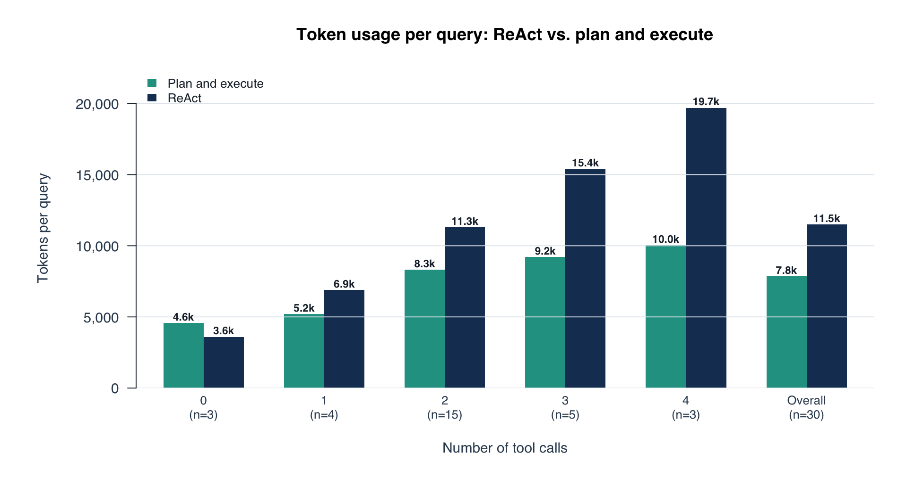
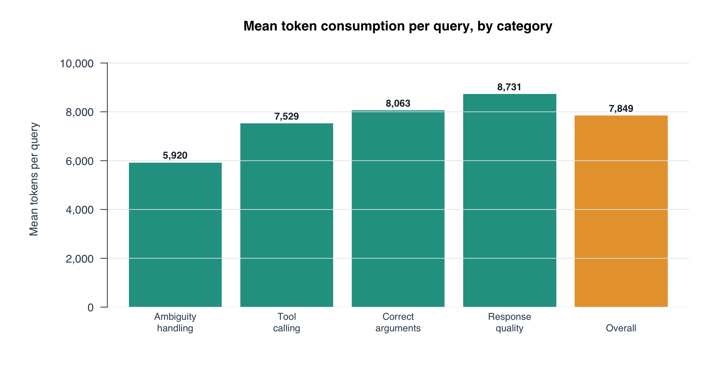
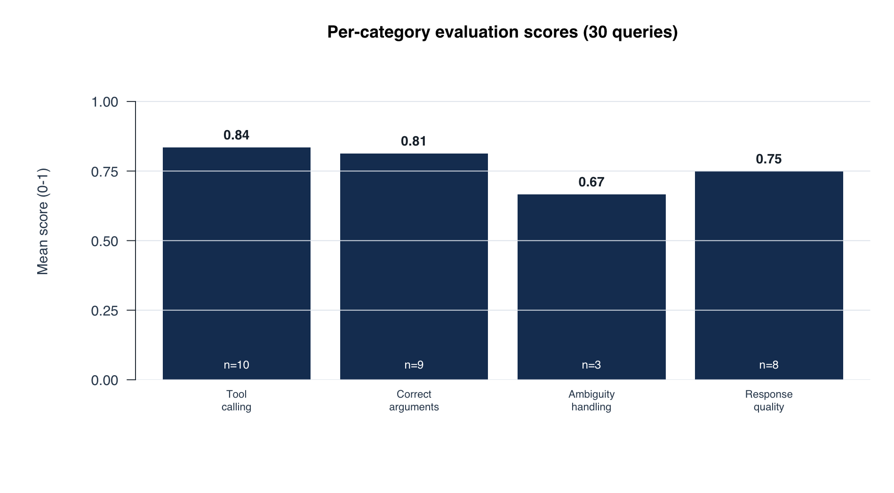

# Al-Osta: Alexandria Multimodal Routing Agent

Al-Osta is a conversational assistant for planning public transport trips in Alexandria, Egypt. It turns Egyptian Arabic requests into geocoding, routing, nearby transit, and traffic queries, then explains the results in natural language. The agent is part of the **Yastaaa** trip planning project; this repository also contains the routing and supporting API services.


## What the system does

- Finds multimodal journeys between named places or coordinates, with options for time, fare, walking distance, transfers, transport modes, and streets.
- Looks up nearby transit services and checks traffic for supported streets.
- Carries recent conversation, tool activity, and trip details across turns so users can refine a request.
- Returns route summaries with estimated time, fare, walking distance, transfers, and modes when the routing service provides them.

The repository includes a command line agent (`main.py`), a local chat interface (`ui_app.py`), and separate REST and gRPC services. The chat interface is a development UI; the Yastaaa mobile application itself is not included here.

## Architecture

The agent uses a **Reasoner → Executor → Synthesizer** flow:

1. **Reasoner:** `gemini-2.5-flash` interprets the request and produces a structured tool plan.
2. **Executor:** Python validates and resolves plan arguments, calls the relevant services, and records their outputs. This stage does not call an LLM.
3. **Synthesizer:** `gemini-2.5-flash-lite` uses the request, tool outputs, and conversation context to write the response.



| Agent tool | Purpose | Backing service |
| --- | --- | --- |
| `geocode_location` | Resolve an Alexandria place name to coordinates | Geocoding API, port `8003` |
| `get_routes` | Find and rank journeys between coordinates | Routing API, port `8000` |
| `db_tools` | Find transit trips near a coordinate | DB Tools API, port `8002` |
| `check_traffic` | Check traffic for a supported street | Traffic Updater API, port `8001` |

The routing service loads the bundled GTFS and OpenStreetMap data, builds a transit and walking network, estimates journey cost and time, filters candidates, and ranks the returned routes. Its local network caches are in `data/utils/`. The DB Tools service requires a separate PostgreSQL database; the repository does not provision it.

### Conversation memory

The agent keeps three bounded forms of state:

- **ConversationBuffer:** recent user and assistant turns, for follow-up references.
- **ToolLog:** recent tool calls and compact results, to help avoid repeated lookups.
- **TripState:** structured origin, destination, preferences, recent locations, and route context.

Before planning a turn, the Reasoner receives relevant memory. After tool execution, the state is updated and supplied to the Synthesizer. See `memory/` for the implementations.



## Getting started

### Prerequisites

- Python 3.10 or newer.
- A Gemini API key for the agent.
- Network access for Gemini and the geocoding and traffic integrations.
- A PostgreSQL database with the expected transit data and `SUPABASE_*` connection settings if using nearby transit queries.

From the repository root, install the declared dependencies plus the two packages imported by the agent tools but currently absent from `requirements.txt`:

```bash
python3 -m venv .venv
source .venv/bin/activate
python -m pip install -r requirements.txt
python -m pip install google-genai requests
```

Create a local `.env` file (it is ignored by Git) with the credentials you need:

```dotenv
GEMINI_API_KEY=your_key_here
# Required only for the DB Tools service:
SUPABASE_HOST=your_postgres_host
SUPABASE_PORT=6543
SUPABASE_DB_NAME=postgres
SUPABASE_DB_USER=your_user
SUPABASE_DB_PASSWORD=your_password
DB_TOOLS_BASE_URL=http://localhost:8002
```

Start each required service in a separate terminal from the repository root:

```bash
python -m uvicorn routing_api.main:app --port 8000
python -m uvicorn traffic_updater.main:app --port 8001
python -m uvicorn db_tools.main:app --port 8002
python -m uvicorn geocoding_api.main:app --port 8003
```

The agent calls the routing, traffic, and geocoding services directly on `localhost`. Set `DB_TOOLS_BASE_URL=http://localhost:8002` because the DB Tools client otherwise defaults to port `8086`. The routing service may take time to load its network data at startup. Start DB Tools only when its database has been configured; queries that depend on it will otherwise fail.

Run the command line assistant or the development chat UI:

```bash
python main.py
# or, in another terminal:
python -m uvicorn ui_app:app --port 8080
```

Open `http://localhost:8080` for the UI. For example, ask: `ازاي اروح من محطة مصر لستانلي بأقل تكلفة؟`

## Benchmark methodology

The committed benchmark consists of [30 Egyptian Arabic prompts](evals/dataset.json) and one saved [evaluation run](evals/eval_results.json). Each prompt belongs to **one** category, and each category score is the mean of its cases.

| Category | Cases | How it is scored |
| --- | ---: | --- |
| Tool calling | 10 | Deterministic, count aware F1 over expected and planned tool names; call order is ignored. |
| Correct arguments | 9 | Fraction of expected **static** argument values matched in the plan, averaged over cases. Dynamic references such as `$destination.lat` are skipped. |
| Response quality | 8 | Scores of 0, 0.5, or 1 for how fully the final answer addresses the request. |
| Ambiguity handling | 3 | Local heuristic checks whether clarification was requested without tool calls when the prompt requires it. |

The evaluator runs a fresh agent instance for each prompt, records the Reasoner plan, tool results, final response, judgment, and agent token count, then writes the JSON report.

### Reproduce the benchmark

With the services running and `GEMINI_API_KEY` set, run:

```bash
python evals/eval.py --output evals/eval_results.local.json
```

The output path above preserves the committed result file. The default runner pauses for 300 seconds after each batch of five prompts. Use `--batch-size` and `--pause-seconds` to change that schedule. `GEMINI_JUDGE_API_KEY` can supply a separate judge key, and `--judge-model` selects the judge model (default: `gemini-2.5-flash`).

## Results

Across 30 queries, Al-Osta performed best at tool calling (**0.84**), followed by correct arguments (**0.81**) and response quality (**0.75**). Ambiguity handling scored **0.67**. The agent used an average of **7,849 tokens per query**, compared with approximately **11,500** for ReAct in the supplied comparison.







## Repository map

```text
agent.py             Reasoner, executor, synthesizer, and turn orchestration
main.py              Command line chat entry point
ui_app.py            Local web chat interface
llm_client.py        Gemini client and token usage capture
memory/              Conversation, tool, and trip state
tools/               Agent tool schemas and HTTP clients
routing_api/         Journey search, filtering, ranking, and REST/gRPC API
geocoding_api/       Place lookup and REST/gRPC API
db_tools/            Database-backed nearby transit queries
traffic_updater/     Traffic and travel-time update service
data/                GTFS feed, map data, and routing caches
evals/               Benchmark prompts, evaluator, saved results, and charts
prompts/             Reasoner and Synthesizer instructions
```
